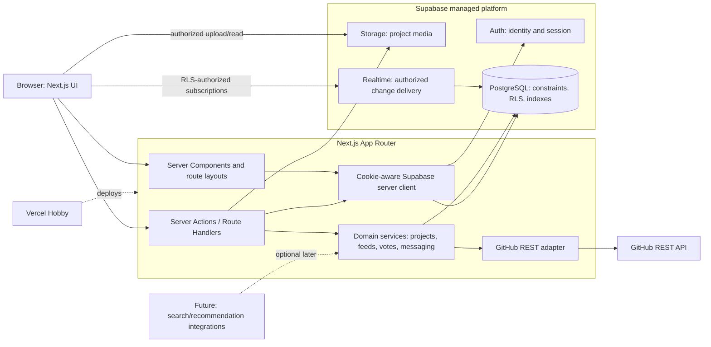

# CodeBloom Architecture

**Project:** CodeBloom  
**Tagline:** Discover. Discuss. Build upon.  
**Status:** Architectural target. A Phase 2 preview frontend is implemented locally; production database, authorization, integration, and deployment contracts still require implementation and verification.

## Goals and boundaries

CodeBloom is a project-centered developer community. Public discovery and discussion are central; private messaging is explicitly acceptance-gated. The first release should use Next.js App Router, React, strict TypeScript, Tailwind CSS, shadcn/ui, Lucide, Supabase (PostgreSQL, Auth, Storage, Realtime), Vitest, React Testing Library, Playwright, and Vercel Hobby / Supabase Free subject to current limits.

Do not add a separate Express service, Redis, paid infrastructure, or an AI dependency without a demonstrated requirement. GitHub remains authoritative for source code, forks, branches, and pull requests. CodeBloom stores links and selectively cached repository metadata.

## System architecture



### Existing managed functionality versus application-owned logic

| Capability | Supabase/platform responsibility | CodeBloom responsibility |
|---|---|---|
| Authentication | Auth user identity, OAuth provider flow, token/session primitives | Profile lifecycle, callback routing, session-aware UI and server guards |
| Database | PostgreSQL hosting, transactions, constraints, RLS, indexes | Schema/migrations, policies, validated domain operations, feed queries and ranking |
| Files | Object storage and signed URL primitives | Bucket policy, ownership checks, path convention, file validation, media metadata and cleanup |
| Realtime | Change delivery and channel transport | Secure channel/topic design, RLS authorization, reconnect/refetch behavior; no treating events as durable truth |
| GitHub | Repository authority and REST API | Server-only adapter, mapping, cache freshness, graceful degradation and link rendering |
| Hosting | Vercel deployment/runtime | Build configuration, environment setup, migrations, monitoring and release process |
| Abuse controls | Database constraints and platform limits | Business rate limits, anti-abuse signals, moderation workflow and ranking guardrails |

## Request and session flow

1. Public routes render in Next.js Server Components and query only data permitted for public visibility. User-specific output must not be put in a shared cache.
2. A cookie-aware Supabase SSR client is created separately for server and browser environments. Middleware/session helpers refresh session cookies as recommended for the installed Supabase SSR package.
3. Supabase Auth owns identity. GitHub OAuth, if enabled, authenticates through Supabase Auth; `profiles.id` references `auth.users.id`.
4. Server Actions/Route Handlers parse and validate every mutation, verify the authenticated user and business authorization, and call domain services. PostgreSQL constraints and RLS remain authoritative.
5. Browser clients may perform only narrowly permitted RLS-protected operations, such as an authorized Realtime subscription or direct upload covered by Storage policies. Privileged mutations should use a server-side service method or narrowly scoped database function.
6. The Supabase service-role key is server-only and is not a routine bypass for user-facing code. Prefer user-scoped clients and RLS. If a trusted job needs elevated access, isolate it and validate every input.

## Data domains

Identity is in Supabase `auth.users` plus application `profiles` and `user_follows`. Project discovery uses `projects`, `project_tags`, `project_media`, `project_updates`, `project_relationships`, and `bookmarks`. Community interaction uses `posts`, threaded `comments`, one-active-vote `votes`, and `notifications`. Private communication uses `chat_requests`, `conversations`, `conversation_participants`, `messages`, and `user_blocks`. Safety uses `reports` and `moderation_actions`.

Use UUID IDs and UTC `timestamptz` timestamps. `created_at` is immutable; mutable rows also have `updated_at`. Comments use `parent_comment_id`; a composite FK `(parent_comment_id, post_id)` ensures a reply's parent is on the same post. Project links are explicit typed rows such as `inspired_by`, `forked_from`, `alternative_to`, and `related_to`. Derived counts should not be copied into authoritative rows initially.

See [database-schema.md](database-schema.md) for table attributes, constraints, indexes, and ownership requirements. Voting, ranking, messaging authorization, and security are specified in [security.md](security.md).

## GitHub metadata policy

The server-side GitHub adapter accepts normalized repository identity, calls GitHub REST API, and maps only needed fields (description, default branch, stars, forks, language, pushed time). Cache these with `github_metadata_fetched_at` and treat them as stale-able snapshots—not authoritative project data. Refresh on project submission and later by explicit or bounded refresh subject to rate limits. GitHub outages must not break the CodeBloom project page. GitHub remains responsible for clone/fork/PR workflows. Never expose a GitHub OAuth client secret or privileged token to the browser.

See [github-integration.md](github-integration.md) for URL validation, README/topics/releases, API rate limiting and cache behavior, OAuth boundaries, and renamed/inaccessible repository handling. See [setup.md](setup.md) for required versus optional environment configuration and credential-free development/testing guidance.

## Feed architecture

Feed query modules in `lib/feeds/` provide New, Hot, Top, Rising, and Following modes. Use deterministic keyset pagination with a tie-breaker ID. Begin with transparent formulas over community interactions and recency, not lifetime counts alone. Keep rank constants and scoring functions in one tested module. Avoid materialized aggregates until observed query load warrants them. Detailed initial formulas and safeguards are in `security.md`.

## Media

Store screenshots/images in a dedicated Supabase Storage bucket, not PostgreSQL. `project_media` stores object path, project ID, alt text, display order, and timestamp. Restrict writes to project owners, validate allowed MIME types and byte limits server-side, and ensure bucket policies align with project visibility. Private assets use short-lived signed URLs after authorization. Cleanup must be retry-safe because database rows and object storage are not one atomic transaction.

## Maintainable project structure

```text
app/
  (public)/page.tsx
  (public)/projects/page.tsx
  (public)/projects/[projectId]/page.tsx
  (auth)/auth/callback/route.ts
  api/github/repository/route.ts
  layout.tsx
  globals.css
components/
  ui/                 # shadcn/ui primitives
  layout/             # header, navigation, shared shell
  projects/           # project-card, project-meta, project-form
lib/
  auth/               # session helpers and guards
  supabase/           # browser.ts, server.ts, middleware.ts
  github/             # API adapter, mapping, cache policy
  feeds/              # feed query and ranking
  votes/              # vote mutation and aggregate queries
  messaging/          # request transitions and participant checks
  notifications/      # durable notification operations
  validation/         # request schemas
  services/           # cross-domain orchestration only when needed
types/database.ts     # generated from Supabase schema
supabase/
  migrations/
  seed.sql
  config.toml
tests/
  unit/
  integration/
  e2e/
docs/
```

Use kebab-case file and route names, PascalCase React component names, camelCase TypeScript identifiers, and SQL `snake_case`. Keep domain logic in domain folders; do not create generic repositories or abstractions without repeated concrete need. Generated database types must be regenerated from the actual schema.

## Deployment and configuration

Deploy Next.js to Vercel Hobby and PostgreSQL/Auth/Storage/Realtime to Supabase, subject to each service's current terms and limits. Use separate Supabase projects for production and non-production where feasible. Apply checked-in migrations to non-production first, then production. Set exact OAuth redirect/callback URLs in Supabase and GitHub OAuth settings; use HTTPS in deployed environments.

Local secrets belong in ignored `.env.local`; deployment secrets belong in provider-encrypted environment settings. `.env.example` documents names only. Public variables may use `NEXT_PUBLIC_`; service-role keys and OAuth client secrets never do. Run typecheck, Vitest, and Playwright smoke tests before release. Ensure logs avoid session tokens, message bodies, and sensitive report data.

## Initial delivery sequence

1. Review schema/RLS design and create migrations with tests.
2. Configure Supabase SSR clients, strict TypeScript, lint/test tooling, and `.env.example`.
3. Implement profiles and public project reads/writes with RLS tests.
4. Add posts/comments/votes and feed modes using the rules in the security design.
5. Add accepted-request messaging only after transactional RPC/RLS and Realtime isolation tests exist.

This document specifies architecture, not a claim that these features or policies are already implemented.
